# Лабораторная работа 4
## Прогнозирование погодных условий с использованием нечёткой логики Мамдани

**Выполнил:** Severcenco Srghei  
**Группа:** IA2404  
**Факультет:** математики и информатики  
**Специальность:** прикладная математика  

---

## 1. Цель лабораторной работы

Целью лабораторной работы является разработка интеллектуальной системы прогнозирования вероятности осадков на основе нечёткой логики Мамдани.

В ходе работы необходимо изучить основные этапы нечёткого вывода, реализовать фаззификацию входных переменных, применение нечётких правил, агрегацию результатов и дефаззификацию методом центроида.

Также необходимо создать интерактивное приложение с возможностью изменения исходных данных, повторного выполнения расчётов и визуализации функций принадлежности.

## 2. Описание предметной области

В данной лабораторной работе разработана система прогнозирования погодных условий.

Программа оценивает вероятность осадков на основе трёх параметров окружающей среды:

- температуры воздуха;
- относительной влажности;
- атмосферного давления.

На основании введённых значений система выполняет нечёткий логический вывод и определяет итоговый индекс осадков в диапазоне от 0 до 100.

Результат дополнительно интерпретируется как низкий, средний или высокий уровень вероятности осадков.

Полученный индекс является результатом модели и не представляет собой калиброванную метеорологическую вероятность.

## 3. Используемые технологии

Для реализации программы были выбраны следующие технологии:

| Технология | Назначение |
|---|---|
| Python | Основной язык программирования |
| Streamlit | Создание интерактивного интерфейса |
| NumPy | Математические вычисления |
| Matplotlib | Построение графиков |

Алгоритм нечёткого вывода Мамдани реализован самостоятельно с использованием стандартных математических операций и функций библиотеки NumPy.

## 4. Входные и выходные переменные

### 4.1. Входные переменные

В программе используются три входные переменные.

| Переменная | Диапазон | Нечёткие множества |
|---|---|---|
| Температура | -20...40 °C | Низкая, средняя, высокая |
| Влажность | 0...100 % | Низкая, средняя, высокая |
| Давление | 950...1050 гПа | Низкое, среднее, высокое |

### 4.2. Выходная переменная

Выходной переменной является индекс осадков.

| Переменная | Диапазон | Нечёткие множества |
|---|---|---|
| Индекс осадков | 0...100 | Низкий, средний, высокий |

## 5. Функции принадлежности

Для каждой переменной были созданы три нечётких множества.

Функции принадлежности задаются с помощью характерных точек, между которыми выполняется линейная интерполяция.

Степень принадлежности принимает значения от 0 до 1:

- 0 — значение не принадлежит множеству;
- 1 — полная принадлежность;
- промежуточные значения — частичная принадлежность.

Использование пересекающихся функций позволяет одному входному значению одновременно принадлежать нескольким нечётким множествам.

### 5.1. Температура

Используются множества:

- низкая;
- средняя;
- высокая.

### 5.2. Влажность

Используются множества:

- низкая;
- средняя;
- высокая.

### 5.3. Атмосферное давление

Используются множества:

- низкое;
- среднее;
- высокое.

### 5.4. Индекс осадков

Используются множества:

- низкий;
- средний;
- высокий.

### 5.5. Визуализация функций принадлежности

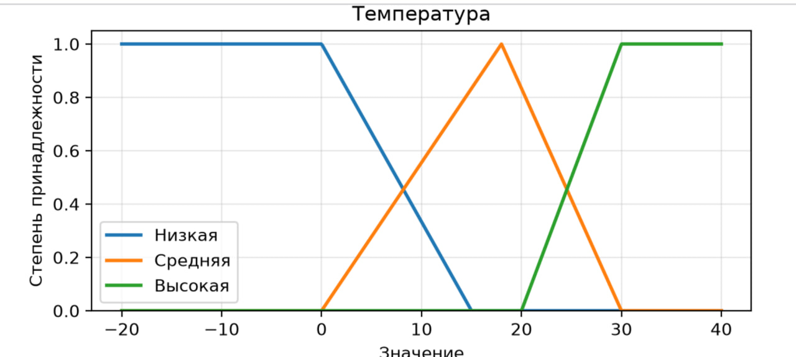
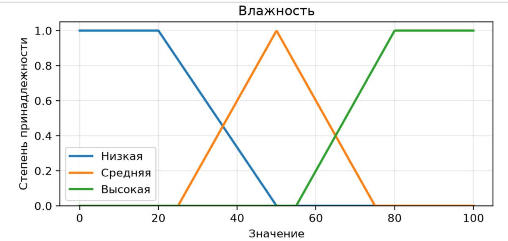
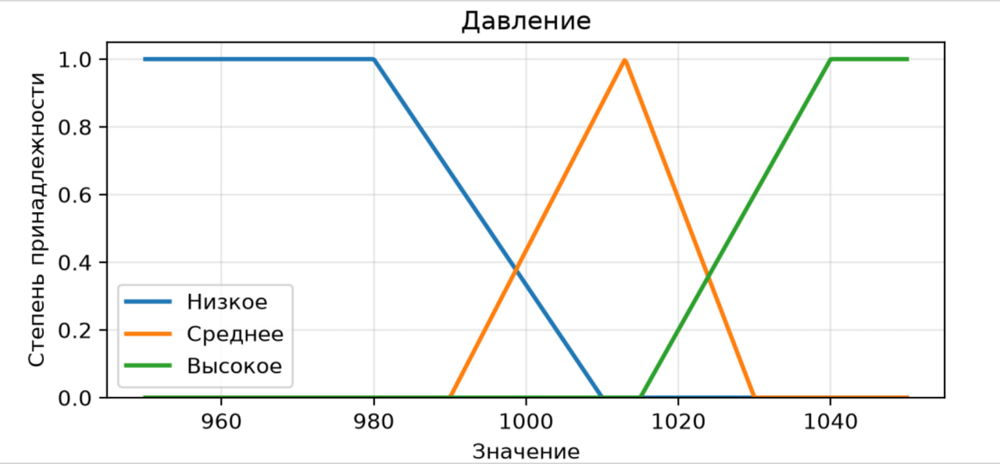
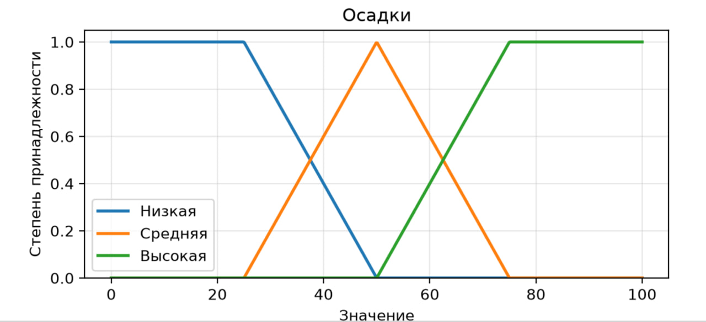
*Рисунок 1 — Графики функций принадлежности входных и выходной переменных.*

## 6. База нечётких правил

В программе реализовано 13 нечётких правил.

Используются логические операторы AND и OR.

| № | Условие | Результат |
|---|---|---|
| 1 | Температура низкая AND влажность высокая | Осадки высокие |
| 2 | Температура средняя AND влажность высокая | Осадки высокие |
| 3 | Температура высокая AND давление высокое | Осадки низкие |
| 4 | Температура высокая AND влажность низкая | Осадки низкие |
| 5 | Давление низкое AND влажность высокая | Осадки высокие |
| 6 | Давление среднее AND влажность средняя | Осадки средние |
| 7 | Температура низкая AND давление низкое | Осадки высокие |
| 8 | Температура средняя AND давление высокое | Осадки низкие |
| 9 | Температура высокая AND влажность средняя | Осадки средние |
| 10 | Давление низкое OR влажность высокая | Осадки высокие |
| 11 | Влажность низкая | Осадки низкие |
| 12 | Влажность средняя | Осадки средние |
| 13 | Влажность высокая | Осадки высокие |

## 7. Алгоритм Мамдани

Работа программы основана на пяти основных этапах.

### 7.1. Фаззификация

На данном этапе числовые входные значения преобразуются в степени принадлежности соответствующим нечётким множествам.

Для вычисления используется линейная интерполяция.

### 7.2. Операторы AND и OR

Для оператора AND используется минимум:

$$
\mu_{AND} = \min(\mu_1,\mu_2)
$$

Для оператора OR используется максимум:

$$
\mu_{OR} = \max(\mu_1,\mu_2)
$$

### 7.3. Импликация

Для ограничения выходной функции принадлежности используется оператор минимума:

$$
\mu'(z) = \min(\alpha,\mu(z))
$$

Где $\alpha$ — степень активации правила.

### 7.4. Агрегация

Результаты всех активированных правил объединяются с помощью операции максимума:

$$
\mu_{agg}(z) = \max(\mu'_1(z),...,\mu'_n(z))
$$

### 7.5. Дефаззификация

Для получения итогового числового значения используется метод центроида:

$$
z^* = \frac{\int z\mu_{agg}(z)\,dz}{\int \mu_{agg}(z)\,dz}
$$

В программе интегрирование выполняется численно с использованием NumPy.

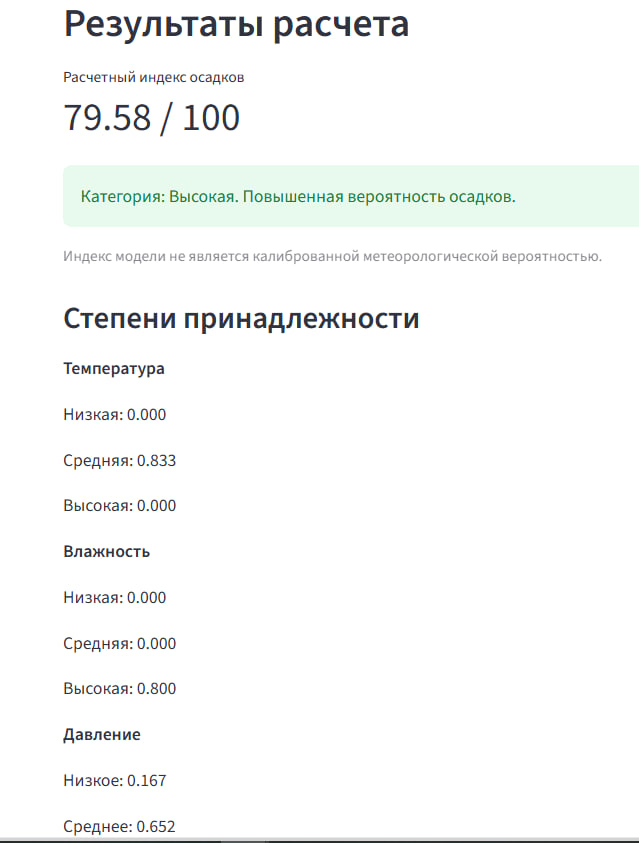
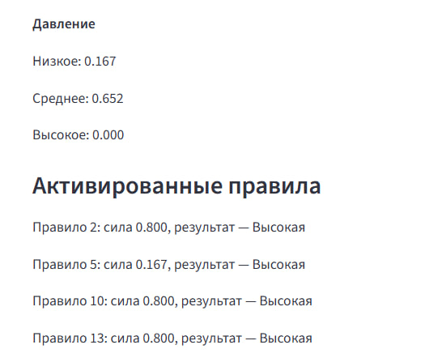
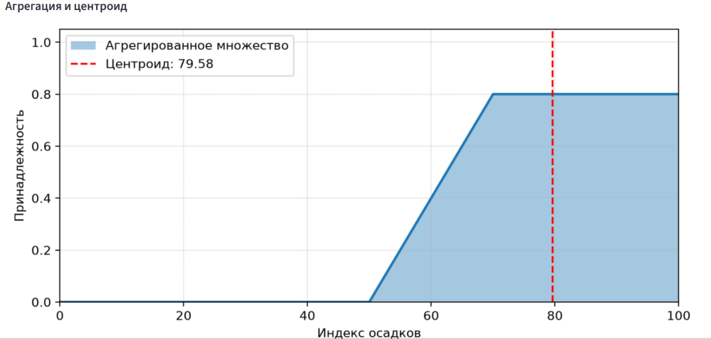

*Рисунок 2 — Результат агрегации и дефаззификации методом центроида.*

## 8. Пользовательский интерфейс

Для взаимодействия с системой используется библиотека Streamlit.

Интерфейс позволяет:

- вводить температуру воздуха;
- задавать относительную влажность;
- задавать атмосферное давление;
- запускать расчёт;
- просматривать графики функций принадлежности;
- получать численный результат;
- просматривать активированные нечёткие правила;
- повторно выполнять расчёты без перезапуска программы.


*Рисунок 3 — Главный интерфейс приложения.*

## 9. Тестирование программы

Для проверки правильности работы системы были подготовлены три тестовых сценария.

| № | Температура | Влажность | Давление | Ожидаемый результат |
|---|---:|---:|---:|---|
| 1 | 30 °C | 20 % | 1040 гПа | Низкий индекс |
| 2 | 20 °C | 50 % | 1013 гПа | Средний индекс |
| 3 | 10 °C | 90 % | 980 гПа | Высокий индекс |

### 9.1. Первый тест — сухая погода

Исходные данные:

- температура: 30 °C;
- влажность: 20 %;
- давление: 1040 гПа.


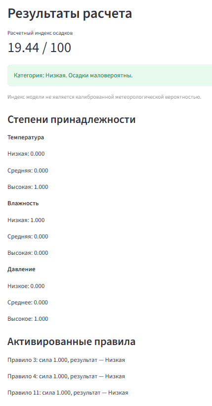
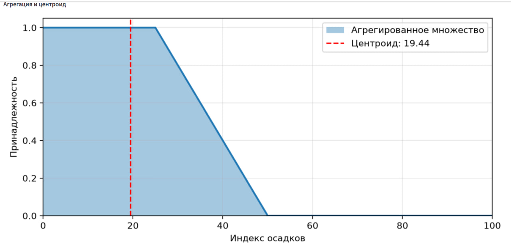

*Рисунок 4 — Результат первого тестового сценария.*

### 9.2. Второй тест — умеренные погодные условия

Исходные данные:

- температура: 20 °C;
- влажность: 50 %;
- давление: 1013 гПа.


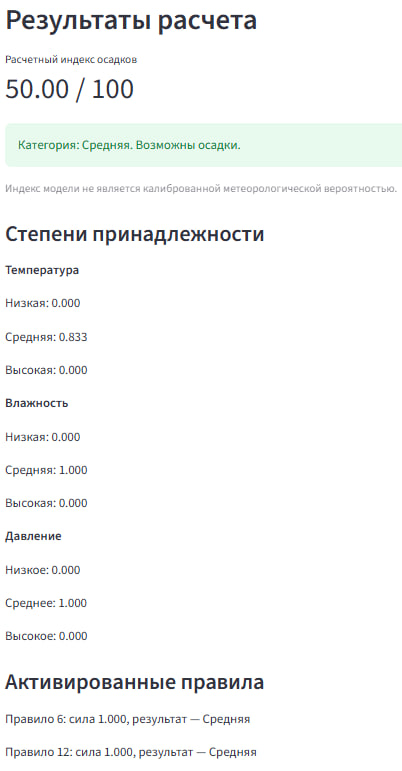
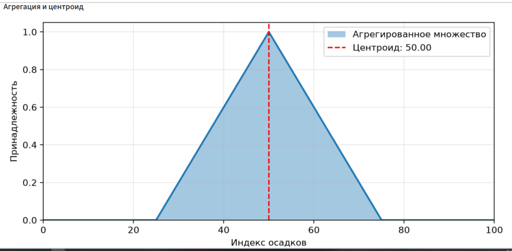


*Рисунок 5 — Результат второго тестового сценария.*

### 9.3. Третий тест — условия с высокой влажностью

Исходные данные:

- температура: 10 °C;
- влажность: 90 %;
- давление: 980 гПа.


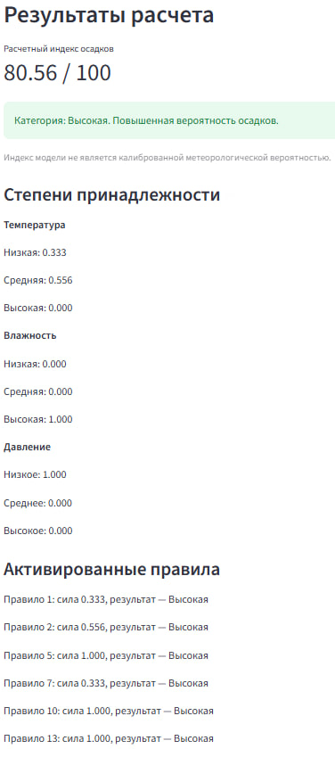
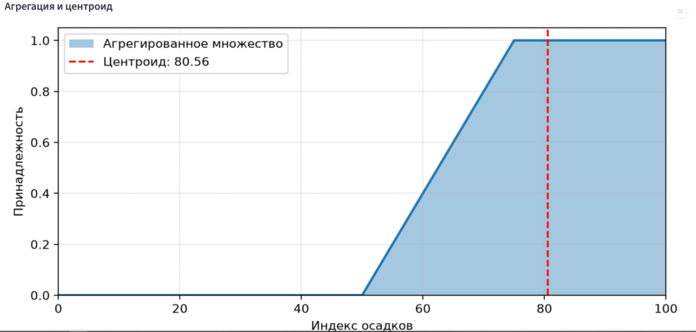

*Рисунок 6 — Результат третьего тестового сценария.*

## 10. Обработка некорректных данных

В программе предусмотрена проверка входных значений.

Система проверяет:

- наличие числовых значений;
- соответствие значений допустимым диапазонам;
- отсутствие бесконечных и некорректных числовых значений.

При обнаружении ошибки приложение отображает соответствующее сообщение и не выполняет расчёт.


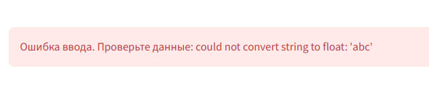

*Рисунок 7 — Проверка обработки некорректных входных данных.*

## 11. Код программы
```python
import streamlit as st
import numpy as np
import matplotlib.pyplot as plt

st.set_page_config(
    page_title="Нечеткий прогноз погоды",
    layout="wide"
)

st.title("Прогнозирование вероятности осадков")
st.write("Нечеткая система на основе алгоритма Мамдани")

variables = {
    "Температура": {
        "Низкая": ([-20, 0, 15], [1, 1, 0]),
        "Средняя": ([0, 18, 30], [0, 1, 0]),
        "Высокая": ([20, 30, 40], [0, 1, 1])
    },
    "Влажность": {
        "Низкая": ([0, 20, 50], [1, 1, 0]),
        "Средняя": ([25, 50, 75], [0, 1, 0]),
        "Высокая": ([55, 80, 100], [0, 1, 1])
    },
    "Давление": {
        "Низкое": ([950, 980, 1010], [1, 1, 0]),
        "Среднее": ([990, 1013, 1030], [0, 1, 0]),
        "Высокое": ([1015, 1040, 1050], [0, 1, 1])
    },
    "Осадки": {
        "Низкая": ([0, 25, 50], [1, 1, 0]),
        "Средняя": ([25, 50, 75], [0, 1, 0]),
        "Высокая": ([50, 75, 100], [0, 1, 1])
    }
}

ranges = {
    "Температура": (-20, 40),
    "Влажность": (0, 100),
    "Давление": (950, 1050),
    "Осадки": (0, 100)
}


def membership(value, points):
    xs, ys = points
    return np.interp(value, xs, ys)


rules = [
    ([("Температура", "Низкая"),
      ("Влажность", "Высокая")], "AND", "Высокая"),

    ([("Температура", "Средняя"),
      ("Влажность", "Высокая")], "AND", "Высокая"),

    ([("Температура", "Высокая"),
      ("Давление", "Высокое")], "AND", "Низкая"),

    ([("Температура", "Высокая"),
      ("Влажность", "Низкая")], "AND", "Низкая"),

    ([("Давление", "Низкое"),
      ("Влажность", "Высокая")], "AND", "Высокая"),

    ([("Давление", "Среднее"),
      ("Влажность", "Средняя")], "AND", "Средняя"),

    ([("Температура", "Низкая"),
      ("Давление", "Низкое")], "AND", "Высокая"),

    ([("Температура", "Средняя"),
      ("Давление", "Высокое")], "AND", "Низкая"),

    ([("Температура", "Высокая"),
      ("Влажность", "Средняя")], "AND", "Средняя"),

    ([("Давление", "Низкое"),
      ("Влажность", "Высокая")], "OR", "Высокая"),

    ([("Влажность", "Низкая")], "AND", "Низкая"),

    ([("Влажность", "Средняя")], "AND", "Средняя"),

    ([("Влажность", "Высокая")], "AND", "Высокая")
]


def mamdani(values):
    fuzzy = {}

    for variable in values:
        fuzzy[variable] = {}
        for term, points in variables[variable].items():
            fuzzy[variable][term] = float(
                membership(values[variable], points)
            )

    x = np.linspace(0, 100, 1001)
    aggregated = np.zeros_like(x)

    active_rules = []

    for number, (conditions, operator, result) in enumerate(
        rules, start=1
    ):
        degrees = [
            fuzzy[var][term]
            for var, term in conditions
        ]

        if operator == "AND":
            strength = min(degrees)
        else:
            strength = max(degrees)

        output_membership = membership(
            x, variables["Осадки"][result]
        )

        clipped = np.minimum(strength, output_membership)

        aggregated = np.maximum(aggregated, clipped)

        if strength > 0:
            active_rules.append((number, strength, result))

    area = np.trapezoid(aggregated, x)

    if area <= 0:
        return fuzzy, None, aggregated, active_rules

    centroid = (
        np.trapezoid(x * aggregated, x) / area
    )

    return fuzzy, centroid, aggregated, active_rules


st.header("Входные данные")

with st.form("weather_form"):
    col1, col2, col3 = st.columns(3)

    with col1:
        temp_text = st.text_input(
            "Температура (°C)",
            value="20"
        )

    with col2:
        humidity_text = st.text_input(
            "Влажность (%)",
            value="75"
        )

    with col3:
        pressure_text = st.text_input(
            "Давление (гПа)",
            value="1005"
        )

    calculate = st.form_submit_button(
        "Рассчитать прогноз"
    )


def show_membership_graph(variable, current_value=None):
    minimum, maximum = ranges[variable]
    x = np.linspace(minimum, maximum, 500)

    fig, ax = plt.subplots(figsize=(7, 3))

    for term, points in variables[variable].items():
        ax.plot(
            x,
            membership(x, points),
            label=term,
            linewidth=2
        )

    if current_value is not None:
        ax.axvline(
            current_value,
            color="black",
            linestyle="--",
            label="Ввод"
        )

    ax.set_title(variable)
    ax.set_xlabel("Значение")
    ax.set_ylabel("Степень принадлежности")
    ax.set_ylim(0, 1.05)
    ax.grid(alpha=0.3)
    ax.legend()

    return fig


st.header("Функции принадлежности")

for name in variables:
    fig = show_membership_graph(name)
    st.pyplot(fig)
    plt.close(fig)


if calculate:
    try:
        temp = float(temp_text.replace(",", "."))
        humidity = float(humidity_text.replace(",", "."))
        pressure = float(pressure_text.replace(",", "."))

        values = {
            "Температура": temp,
            "Влажность": humidity,
            "Давление": pressure
        }

        for variable, value in values.items():
            minimum, maximum = ranges[variable]

            if not np.isfinite(value):
                raise ValueError(
                    f"{variable}: требуется конечное число"
                )

            if not minimum <= value <= maximum:
                raise ValueError(
                    f"{variable}: допустимо от "
                    f"{minimum} до {maximum}"
                )

        fuzzy, result, aggregated, active = mamdani(values)

        if result is None:
            st.warning("Не активировано ни одно правило.")
        else:
            st.header("Результаты расчета")

            if result < 35:
                category = "Низкая"
                message = "Осадки маловероятны."
            elif result < 65:
                category = "Средняя"
                message = "Возможны осадки."
            else:
                category = "Высокая"
                message = "Повышенная вероятность осадков."

            st.metric(
                "Расчетный индекс осадков",
                f"{result:.2f} / 100"
            )

            st.success(
                f"Категория: {category}. {message}"
            )

            st.caption(
                "Индекс модели не является "
                "калиброванной метеорологической вероятностью."
            )

            st.subheader("Степени принадлежности")

            for variable, terms in fuzzy.items():
                st.write(f"**{variable}**")
                for term, degree in terms.items():
                    st.write(f"{term}: {degree:.3f}")

            st.subheader("Активированные правила")

            for number, strength, output in active:
                st.write(
                    f"Правило {number}: "
                    f"сила {strength:.3f}, "
                    f"результат — {output}"
                )

            st.subheader("Агрегация и центроид")

            x = np.linspace(0, 100, 1001)
            fig, ax = plt.subplots(figsize=(9, 4))

            ax.fill_between(
                x, aggregated, alpha=0.4,
                label="Агрегированное множество"
            )

            ax.plot(
                x, aggregated,
                linewidth=2
            )

            ax.axvline(
                result,
                color="red",
                linestyle="--",
                label=f"Центроид: {result:.2f}"
            )

            ax.set_xlim(0, 100)
            ax.set_ylim(0, 1.05)
            ax.set_xlabel("Индекс осадков")
            ax.set_ylabel("Принадлежность")
            ax.grid(alpha=0.3)
            ax.legend()

            st.pyplot(fig)
            plt.close(fig)

    except ValueError as error:
        st.error(
            "Ошибка ввода. Проверьте данные: "
            + str(error)
        )
```
## 12. Результаты работы

В результате лабораторной работы было разработано интерактивное приложение для прогнозирования вероятности осадков.

Программа выполняет фаззификацию входных параметров, применяет 13 нечётких правил, выполняет импликацию и агрегацию результатов, а также рассчитывает итоговый индекс методом центроида.

Полученные результаты отображаются в числовом и текстовом виде.

Пользователь может изменять исходные параметры и выполнять новые расчёты без перезапуска приложения.

## 13. Вывод

В ходе лабораторной работы была разработана система прогнозирования погодных условий на основе нечёткой логики Мамдани.

Были изучены и реализованы основные этапы нечёткого вывода: фаззификация, применение правил IF–THEN, импликация, агрегация и дефаззификация методом центроида.

Создан интерактивный пользовательский интерфейс с возможностью ввода исходных данных, повторного расчёта и визуализации функций принадлежности.

В результате работы были закреплены практические навыки применения нечёткой логики для решения задач моделирования и принятия решений.
